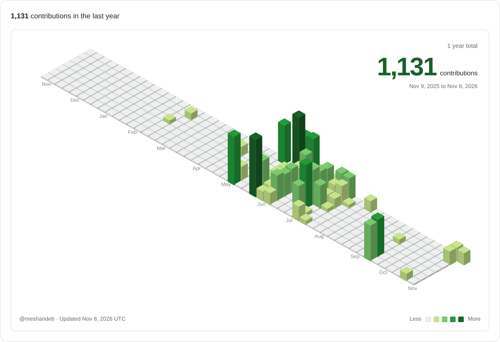

### Tech Stack

---

  <picture>
    <source media="(prefers-color-scheme: dark)" srcset="assets/contribution-skyline-dark.png" />
    <source media="(prefers-color-scheme: light)" srcset="assets/contribution-skyline-light.png" />
    
  </picture>

---

